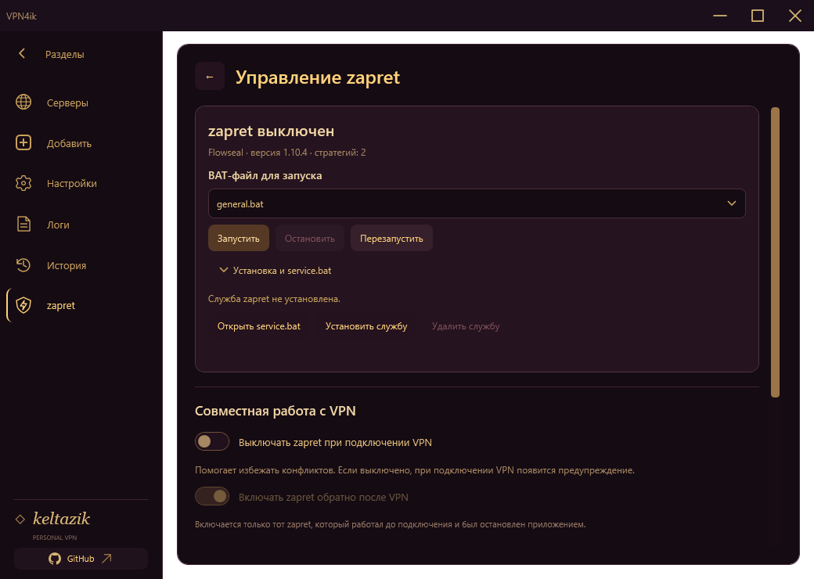

<div align="center">
  
  <h1>VPN4ik</h1>
  <p>Твой VPN и управление zapret — в одном приложении.</p>
  <p><strong>Windows x64 · Без установки · .NET внутри</strong></p>
  <p><a href="https://github.com/keltazik/VPN4ik/releases/tag/v1.0.0-beta.10"><strong>↓ Скачать beta.10</strong></a></p>
  <p><a href="#быстрый-старт">Быстрый старт</a> · <a href="#zapret-прямо-в-приложении">Управление zapret</a> · <a href="CHANGELOG.md">Что нового</a></p>
</div>

---

**VPN4ik** — VPN-клиент с бордово-золотым интерфейсом и орнаментом вместо кнопки подключения. Добавь свою подписку, выбери сервер и подключайся. Во встроенной вкладке zapret можно управлять обходом блокировок и согласовать его работу с VPN.

## Главное

| Возможность | Что получаешь |
| --- | --- |
| **GUI для zapret** | Автопоиск установки, выбор BAT-стратегии, запуск и остановка, управление службой, Game Filter и IPSet |
| **VPN + zapret** | Можно автоматически останавливать zapret при подключении VPN и возвращать после отключения |
| **Режимы подключения** | Системный прокси или TUN с Hiddify Core, DNS через VPN или локальный DNS |
| **Раздельное туннелирование** | Выбирай, какие приложения, сайты и подсети идут через VPN, а какие напрямую; программы можно добавить из запущенных процессов |
| **Свои подписки** | Импорт ссылок и файлов, обновление серверов, поиск, сортировка и переключение сервера |
| **Проверка соединения** | Несколько независимых HTTPS-проверок, статистика скорости и трафика, журнал подключений |
| **Поддержка в Telegram** | Кнопка рядом с GitHub открывает [@VPN4ikSupportBot](https://t.me/VPN4ikSupportBot) |
| **Обновление по кнопке** | Приложение сообщает о новом выпуске и предлагает установить его с сохранением подписок и настроек |

## Быстрый старт

1. Скачай **[VPN4ik-v1.0.0-beta.10-windows-x64.zip](https://github.com/keltazik/VPN4ik/releases/download/v1.0.0-beta.10/VPN4ik-v1.0.0-beta.10-windows-x64.zip)**.
2. Распакуй всю папку и запусти **`VPNyan.exe`**. Папка `Engine` должна оставаться рядом. Устанавливать .NET отдельно не нужно.
3. Открой **＋ Добавить** и импортируй свою подписку или конфигурацию.
4. Выбери сервер и режим подключения, затем нажми на орнамент. Для TUN подтверди запрос Windows и дождись статуса **«Подключено»**.

Подписка и серверы в комплект не входят. Это предварительный выпуск для Windows x64.

## zapret прямо в приложении

Отдельная вкладка объединяет основные действия из `service.bat` в обычный графический интерфейс:

- Автоматический поиск папки zapret и ручной выбор пути.
- Список доступных BAT-стратегий, запуск, остановка и перезапуск.
- Установка и удаление службы Windows, статус службы и установленной стратегии.
- Game Filter с портами TCP/UDP, режим IPSet и обновление списков.
- Диагностика, проверка обновлений и открытие оригинального `service.bat`.

VPN4ik работает с **отдельно установленным [zapret от Flowseal](https://github.com/Flowseal/zapret-discord-youtube)**; сам zapret не включён в архив. Встроенная интеграция проверена на версии 1.10.4.

Опция **«Выключать zapret при подключении»** по умолчанию выключена. Её можно включить, чтобы снизить вероятность конфликтов; возврат zapret после отключения VPN настраивается отдельно.

<p align="center"></p>

## Разделяй трафик

В **Настройки → Маршрутизация** доступны два режима:

- **Выбранное без VPN:** указанные приложения, домены и IP идут напрямую, остальное — через VPN.
- **Только выбранное через VPN:** через VPN идёт только указанное.

Добавляй программы из списка процессов, через выбор `.exe` или вручную. Новые правила применяются после переподключения.

<p align="center"></p>

## Обновления

Когда появится новая версия, в приложении будет плашка **«Доступно обновление»**. Нажми **«Обновить»**: программа скачает и проверит выпуск, затем перезапустится. Если автоматическая установка недоступна, откроется страница релиза. Подписки и настройки сохраняются.

Архив можно скачать и вручную со [страницы выпусков](https://github.com/keltazik/VPN4ik/releases). Его контрольная сумма находится в `SHA256SUMS.txt`.

## Совместимость

Поддерживаются профили **VLESS, VMess, Trojan, Shadowsocks, SOCKS и Hysteria2**, JSON Xray, текстовые и base64-подписки. Для WireGuard доступен импорт `.conf`.

**TUN с Hiddify Core** направляет системный трафик через VPN; серверные протоколы обслуживает Xray. **Прокси** работает с программами, поддерживающими системный HTTP/HTTPS-прокси; для UDP и правил по приложениям нужен TUN. Переключатель локального DNS использует DNS физического подключения, поэтому запросы имён могут быть видны локальной сети.

Раздельное туннелирование по приложениям и доменам относится к Xray; WireGuard использует `AllowedIPs`. Сложные цепочки и балансировщики провайдера, расширенный XHTTP и маскировка Hysteria2 пока не воспроизводятся. Полноценный Kill Switch и восстановление после сна пока не реализованы.

Подробности, ограничения и сборка из исходников — в [документации разработчика](docs/DEVELOPMENT.md). Для сборки нужны Windows x64 и .NET SDK 10:

```powershell
git clone https://github.com/keltazik/VPN4ik.git
cd VPN4ik
powershell -NoProfile -File build.ps1
```

Подписки, история и логи хранятся локально; данные подписок защищены Windows DPAPI. Состав и лицензии сторонних компонентов — в [THIRD_PARTY.md](THIRD_PARTY.md).

---

<p align="center">
  <a href="https://github.com/keltazik/VPN4ik/releases/tag/v1.0.0-beta.10">Скачать</a> ·
  <a href="https://github.com/keltazik/VPN4ik/issues/new?template=bug_report.md">Сообщить об ошибке</a> ·
  <a href="CONTRIBUTING.md">Участие в разработке</a>
</p>
