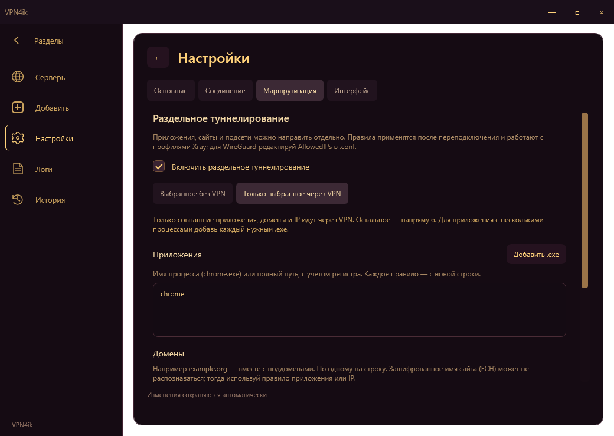
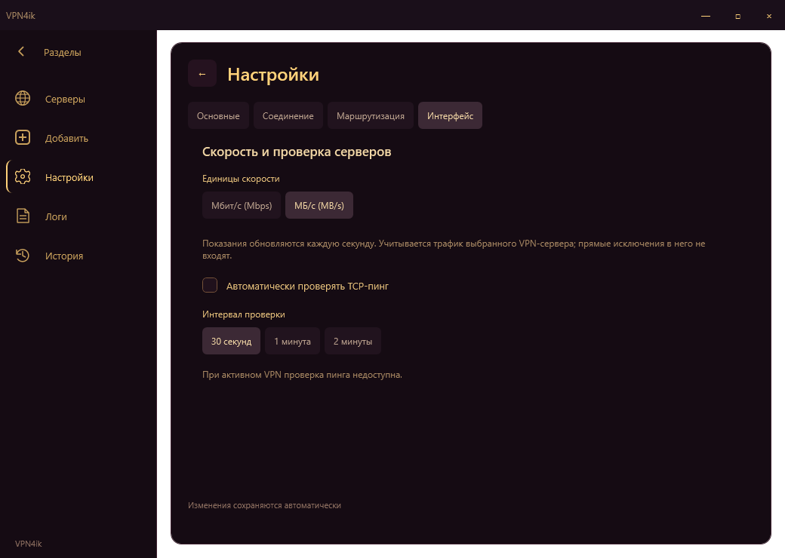

<div align="center">
  
  <h1>VPN4ik</h1>
  <p>Личный VPN-клиент для Windows — для себя, семьи и друзей.</p>
  <p><strong>Windows x64 · Xray TUN · Подписки · Раздельное туннелирование</strong></p>
  <p><a href="../../releases/latest">Скачать готовую версию</a> · <a href="#быстрый-старт">Как подключиться</a> · <a href="CHANGELOG.md">Что нового</a> · <a href="docs/DEVELOPMENT.md">Для разработчиков</a></p>
</div>

---

VPN4ik — приложение с бордово-золотым интерфейсом и орнаментом вместо обычной кнопки подключения. Импортируй свою подписку, выбери сервер и подключайся. Приложение проверяет соединение, показывает скорость и сохраняет историю сеансов.

> **Текущая версия: 1.0.0-beta.1.** Репозиторий закрытый. Ссылка на код и релизы доступна владельцу и приглашённым участникам.

## Скачать

Открой **[Releases → последняя версия](../../releases/latest)** и скачай архив `VPN4ik-v1.0.0-beta.1-windows-x64.zip`. Соседний файл `SHA256SUMS.txt` содержит контрольную сумму.

Распакуй **всю папку** и запусти **`VPNyan.exe`**. Это внутреннее имя исполняемого файла VPN4ik. Устанавливать .NET отдельно не требуется: среда выполнения уже включена. Папка `Engine` должна оставаться рядом с программой.

## Быстрый старт

1. Закрой прежнюю версию VPN4ik, если она запущена.
2. Запусти `VPNyan.exe` из распакованной папки.
3. Нажми **＋ Добавить** на левой панели и импортируй свою HTTPS-подписку или конфигурацию.
4. Открой **Серверы** и выбери нужный сервер.
5. Нажми на орнамент и подтверди запрос Windows на запуск VPN-службы.
6. Дождись статуса **«Подключено»**. Повторное нажатие на орнамент отключает VPN.

Сервисы и серверы в комплект не входят: нужна собственная действующая подписка или конфигурация. Приватные ключи и ссылки доступа в репозитории отсутствуют.

## Что умеет

| Возможность | Как работает |
| --- | --- |
| Подписки и серверы | Импорт по ссылке, обновление подписки, поиск и выбор сервера |
| Подключение | Xray TUN для системного трафика Windows, IPv4 и IPv6 |
| Раздельное туннелирование | Приложения, домены и IP/CIDR; выбранное без VPN или только выбранное через VPN |
| Настройки | Четыре раздела, автосохранение, DNS, MTU и обход локальной сети |
| Скорость и трафик | Статистика Xray раз в секунду, Mbps/MB/s; прямые исключения не учитываются |
| Пинг | Параллельная TCP-проверка; при активном TUN она заблокирована |
| Журнал и история | События и реальные сеансы подключения внутри приложения |
| Хранение данных | Подписки и история защищены Windows DPAPI |
| Интерфейс | Сворачиваемая панель, минимальная подсветка кнопок и точная область нажатия орнамента |

## Раздельное туннелирование

Открой **Настройки → Маршрутизация**. Добавь приложения через выбор `.exe` или введи имя процесса/полный путь. Домены и подсети добавляются по одному правилу на строку.

- **Выбранное без VPN:** совпавшие приложения, сайты и IP идут напрямую; остальное — через VPN.
- **Только выбранное через VPN:** совпавшее идёт через VPN; остальное — напрямую.

Правила разных списков объединяются по принципу «или». Включённый обход локальной сети имеет приоритет. Изменения сохраняются автоматически и применяются **после переподключения**.

<p align="center"></p>

*Снимок тестового интерфейса с примером правил. Пользовательские подписки и секреты не показаны.*

## Настройки без кнопки «Сохранить»

**Основные** — запуск, автоподключение, трей и уведомления. **Соединение** — MTU, DNS и локальная сеть. **Маршрутизация** — правила разделения трафика. **Интерфейс** — единицы скорости и расписание проверки пинга.

<p align="center"></p>

## Поддержка и ограничения

- Основная платформа — **Windows x64**. Android и iOS пока не выпущены.
- Xray-профили: VLESS, VMess, Trojan, Shadowsocks и SOCKS, с поддерживаемыми транспортами TCP/gRPC/WebSocket и TLS/Reality. Расширенные параметры XHTTP и Hysteria2 пока не подключаются.
- WireGuard `.conf` обслуживается отдельной службой. Для него маршрутизация задаётся через `AllowedIPs`; правила приложений/доменов в интерфейсе относятся к Xray. Состояние WireGuard-службы не выдаётся за проверенный handshake.
- Доменные правила могут не распознавать имя сайта при ECH. В таком случае используй приложение или IP.
- Полноценный Kill Switch, автоматическое обновление и восстановление после сна пока не реализованы.
- Это переносимая сборка; установщик не входит в релиз.

## Сборка из исходников

Нужны Windows x64, Git и **.NET SDK 10** (проект приложения использует .NET 8, проверки — .NET 10).

```powershell
git clone https://github.com/keltazik/VPN4ik.git
cd VPN4ik
powershell -NoProfile -File build.ps1
```

Скрипт скачает закреплённый Xray из официального релиза, проверит архив и подпись Wintun, затем создаст автономную сборку в `artifacts/VPN4ik-routing/`. Переносить нужно всю папку.

```powershell
# Проверки логики и размеров интерфейса: без сети и без TUN
powershell -NoProfile -File checks/run.ps1

# Настоящий Xray на локальных серверах: только loopback, без TUN
powershell -NoProfile -File checks/run.ps1 -NativeRouting
```

Текущий выпуск прошёл **208 локальных проверок + 12 проверок Xray**. Подробности устройства приложения и проверки подключения — в [документации разработчика](docs/DEVELOPMENT.md).

## Данные и компоненты

Подписки, история и логи хранятся локально; ключи защищены для текущего пользователя Windows. Не добавляй свои `.conf`, `.dpapi`, токены и ссылки подписок в Git. Для сообщения об ошибке используй [Issues](../../issues) и убери из вложений данные доступа.

Лицензии Xray, Wintun, WireGuard и среды .NET описаны в [THIRD_PARTY.md](THIRD_PARTY.md). Компоненты и их уведомления включены в архив релиза.
