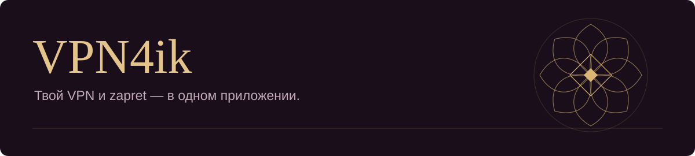

Windows x64 &nbsp;·&nbsp; Без установки &nbsp;·&nbsp; .NET внутри

<a href="https://github.com/keltazik/VPN4ik/releases/latest">Что нового</a> &nbsp;·&nbsp; <a href="https://t.me/VPN4ikSupportBot">Поддержка</a> &nbsp;·&nbsp; <a href="docs/SETTINGS.md">Настройки</a>

## Подключение под твоим контролем

Добавь свою подписку, выбери сервер и подключайся. VPN4ik объединяет VPN, раздельное туннелирование и управление zapret в одном окне.

- **TUN или прокси.** Выбирай системный туннель или подключение для программ с поддержкой HTTP/HTTPS-прокси.
- **Свои правила.** Направляй приложения, сайты и подсети через VPN или напрямую.
- **Подписки.** Импорт, обновление серверов, поиск и средний TCP-пинг за 7 секунд.
- **zapret рядом.** Выбор стратегии, запуск, остановка и управление службой из приложения.
- **Твой интерфейс.** Четыре темы, шесть стилей надписи, орнамент или кнопка питания. Русский, английский и армянский.
- **Настройки с собой.** Профили маршрутизации, диагностика и резервные копии с паролем.

## Начать за минуту

1. [Скачай ZIP для Windows x64](https://github.com/keltazik/VPN4ik/releases/download/v1.0.0/VPN4ik-v1.0.0-windows-x64.zip) и распакуй всю папку.
2. Запусти **VPNyan.exe**. Оставь `Engine` и остальные файлы рядом — .NET уже включён.
3. Добавь свою подписку или конфигурацию, выбери сервер и нажми кнопку подключения. Для TUN подтверди запрос прав Windows.

Серверы и подписка в комплект не входят. [zapret от Flowseal](https://github.com/Flowseal/zapret-discord-youtube) устанавливается отдельно.

> **Переход с beta.10:** скачай версию 1.0.0 вручную, закрой старое приложение и распакуй новую папку отдельно. Старый автоустановщик не принимает дополнительные файлы этого выпуска.

<strong>Протоколы и ограничения</strong>

Поддерживаются VLESS, VMess, Trojan, Shadowsocks, SOCKS и Hysteria2, подписки Xray и импорт WireGuard `.conf`. TUN и DNS обслуживает Hiddify Core, серверные протоколы — Xray. WireGuard использует собственный механизм подключения и `AllowedIPs`.

Прокси работает с программами, использующими системный HTTP/HTTPS-прокси. Для UDP и правил по приложениям нужен TUN. Локальный DNS при включении отправляет запросы через DNS физического подключения.

Kill Switch, Mux/фрагментация и жёсткие лимиты пока не реализованы. Сложные цепочки провайдера, расширенный XHTTP и маскировка Hysteria2 поддерживаются не полностью. Для сборки 1.0.0 пройдены изолированные проверки; полный пользовательский прогон с реальным VPN ещё не выполнен.

<strong>Проверки, данные и исходники</strong>

Для 1.0.0 прошли **857 локальных проверок**, отдельные **201 проверка настроек** и автономный запуск со встроенным .NET 8.0.31. SHA-256 архива опубликован в `SHA256SUMS.txt` на [странице выпуска](https://github.com/keltazik/VPN4ik/releases/tag/v1.0.0).

Подписки, история и журналы хранятся локально; данные подписок защищены Windows DPAPI. В релиз не включены пользовательские ключи и конфигурации.

Для сборки из исходников: Windows x64 и .NET SDK 10, затем `powershell -NoProfile -File build.ps1`. Подробнее — [документация разработчика](docs/DEVELOPMENT.md).

---

Сделано **keltazik**. На основе [Hiddify Core](https://github.com/hiddify/hiddify-core), [Xray](https://github.com/XTLS/Xray-core) и [WireGuard](https://github.com/WireGuard/wireguard-windows). [Компоненты и лицензии](THIRD_PARTY.md).

[Сообщить об ошибке](https://github.com/keltazik/VPN4ik/issues/new?template=bug_report.md) &nbsp;·&nbsp; [История изменений](CHANGELOG.md) &nbsp;·&nbsp; [Участие в проекте](CONTRIBUTING.md)