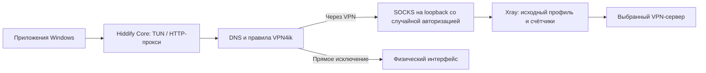

# Сетевое ядро Hiddify в VPN4ik

Локальная интеграция `1.0.0-beta.8+local.3`, 28.10.2026. Интерфейс WPF, навигация, хранилища, `IVpnSession`, именованный канал управления и права службы сохранены. Официальные бинарные файлы Hiddify не изменены.

## Изученные исходники

- [Hiddify App: управление соединением](https://github.com/hiddify/hiddify-app/blob/main/lib/hiddifycore/hiddify_core_service.dart) и [репозиторий подключения](https://github.com/hiddify/hiddify-app/blob/main/lib/features/connection/data/connection_repository.dart): состояния запуска/остановки, отдельное привилегированное ядро, ожидание результата старта и повторная подписка на события.
- [Hiddify Core 5.0.3: запуск sing-box](https://github.com/hiddify/hiddify-core/blob/v5.0.3/cmd/cmd_sing_run.go): конфигурация через stdin, запуск и штатное закрытие по сигналу.
- [Построение TUN и маршрутов](https://github.com/hiddify/hiddify-core/blob/v5.0.3/v2/config/builder.go), [DNS](https://github.com/hiddify/hiddify-core/blob/v5.0.3/v2/config/dns.go), [параметры](https://github.com/hiddify/hiddify-core/blob/v5.0.3/v2/config/hiddify_option.go).
- Windows-комплект: Hiddify Core 5.0.3, ревизия `00a84b00faaed68146ce6a32bf968c5cf7089447`; Hiddify sing-box 1.13.0-rc.2, закреплённый подмодуль `5e94a4e6acf7907755f3a8588ce619d2c29b3f06`.

## Путь пакетов

Hiddify обслуживает TUN со стеком `mixed`, IPv4/IPv6, автоматическими маршрутами и `strict_route`. Перехват DNS по протоколу и порту 53 направляет запросы во встроенный резолвер. Пользовательские DNS работают по TCP через выбранный сервер с последовательным резервированием; локальный DNS использует резолверы физического адаптера напрямую. localhost разрешается локально, включая обращения через HTTP-прокси.

Правила процессов, полных путей, доменов, подсетей, режимов Include/Bypass и исключение LAN переносятся из существующих настроек. Хранимые имена процессов без `.exe` преобразуются в формат Windows, ожидаемый Hiddify. Исходные профили не переписываются. Счётчики выбранного сервера остаются в Xray: прямые исключения их не увеличивают. WireGuard использует прежнюю службу.

Существующий Xray обрабатывает параметры серверных протоколов, включая транспорты и TLS/REALITY. Это сохраняет совместимость профилей и избегает потери параметров при преобразовании между форматами. Для внутреннего возврата к прежнему TUN-пути существует `UseHiddifyCore=false` в настройках; интерфейс выбора режимов не изменён.

## Управление и очистка

Один существующий helper проверяет PID и путь родительского процесса, принимает профиль по защищённому именованному каналу и запускает оба собственных процесса. Данные доступа передаются через stdin/канал, а не аргументы или открытый конфигурационный файл. Сначала поднимается протокольный worker, затем Hiddify. Потеря любого процесса, канала или родителя останавливает всю пару.

Закрытие использует Ctrl+C в отдельной скрытой консоли. Оба ядра штатно освобождают ресурсы; Windows Job ограничивает последствия аварии. В прокси-режиме прежнее состояние системного прокси восстанавливает существующий `SystemProxyLease`. Постоянная служба Hiddify и её gRPC-панель не устанавливаются.

В Hiddify Core 5.0.3 URL-монитор создаётся даже при отсутствии панели управления. Его дополнительные сетевые проверки ограничены локальным URL, тайм-аутом 1 нс и годовым интервалом. Ожидаемые предупреждения этого отключённого дублирующего теста отфильтровываются отдельно от настоящих ошибок ядра. Авторитетная HTTPS-проверка VPN и семисекундные замеры задержки остаются в контроллере VPN4ik.

## Поставка и автообновление

Официальный архив и каждый исполняемый компонент проверяются по закреплённым SHA-256. Архив включён в основной EXE и распаковывается атомарно в `Engine/Hiddify`, с проверкой перед запуском. Конфигурации пользователей в архив не входят. Это позволяет сохранить прежний формат ZIP и список файлов, разрешённый ранее опубликованным автообновлятором.

Проверка `--verify-startup` распаковывает ядро в свой временный каталог отчёта, сохраняя payload обновления неизменным. Релиз следует собирать через `build.ps1` в новую папку; рабочую папку после пользовательского запуска не следует использовать как исходник архива обновления.

## Проверки

- `checks/run.ps1`: структура TUN/DNS, приватные входы, правила, совместимость настроек, отсутствие дополнительных публичных URL-тестов.
- `checks/run.ps1 -NativeRouting`: реальные Hiddify + Xray на loopback, HTTP, Include/Bypass, имя процесса и домен, выделенный физический интерфейс, UDP-ответы, DNS A/AAAA через TCP с отказом основного резолвера и счётчики без прямых исключений. Системные маршруты и прокси не меняются.
- `VPNyan.exe --verify-hiddify-worker <report>`: реальный штатный helper и оба процесса, HTTP и счётчики, коды завершения. Вариант `--wait` предназначен для отдельной проверки потери родителя на изолированных данных.
- Автономный запуск проверяет встроенный .NET и извлечение Hiddify без внешней установки.

Полная проверка привилегированного TUN с изменением маршрутов требует отдельного запуска без конкурирующего VPN. Активный Happ в этой задаче не останавливается.

См. [условия поставщика](../licenses/Hiddify-Core.txt) и [состав сторонних компонентов](../THIRD_PARTY.md). Интеграция включена в выпуск `1.0.0-beta.9`; бинарные компоненты поставщика не изменены.
